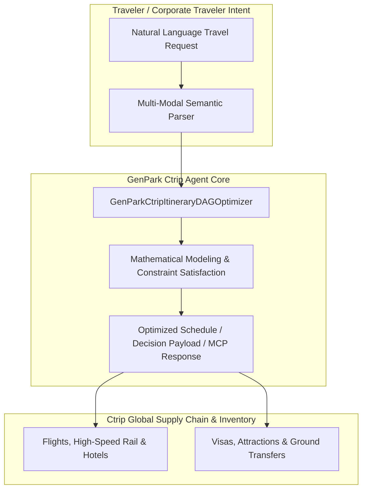

# genpark-ctrip-itinerary-dag-optimizer-skill

<div align="center">

[](https://www.python.org/)
[](LICENSE)
[](https://modelcontextprotocol.io/)
[-brightgreen.svg?style=for-the-badge)](requirements.txt)

<p align="center">
  <b>Production-Grade GenPark Ctrip AI Travel Agent Skill</b> • <b>100% Standard Library Python</b> • <b>Native Model Context Protocol (MCP)</b>
</p>

</div>

---

## Executive Overview & Architectural Motivation

In the era of vertical foundation models, **Ctrip / Trip.com Group** pioneered the travel industry's vertical intelligence platform (**Ctrip Quest / 携程问道**) and multi-agent service ecosystem (**TripGenie** & Corporate Travel Agents). Travel planning inherently presents multi-dimensional combinatorial NP-hard challenges: volatile flight yield curves, fluctuating hotel price parities, international cross-border visa jurisdictions, and peak attraction crowd bottlenecks.

This skill library distills the core mathematical logic and agent orchestration models powering the next-generation **GenPark Ctrip AI Travel Agent OS**:

- **Combinatorial Itinerary Optimization**: Dynamic TSP graph solver with fatigue and opening hour constraints.
- **Yield Management & Price Forecasting**: Probabilistic expected-value airline pricing hazard models.
- **Cross-Surface Compliance & Verification**: Cryptographic policy checks and zero-friction corporate expense auditing.
- **Enterprise Protocol Parity**: Full native Model Context Protocol (MCP) compliance for agentic runtime integration.

---

## Architecture Diagram



---

## Technical Specifications & Features

| Capability | Specification |
| :--- | :--- |
| **Runtime Environment** | Python 3.9+ (Standard Library Only) |
| **External Dependencies** | **None (0 packages)** |
| **Protocol Compatibility** | Anthropic Model Context Protocol (MCP) STDIO JSON-RPC 2.0 |
| **Architecture Paradigm** | Pure Functional & Mathematical Modeling |
| **Deployment Mode** | Headless Agent Skill, CLI Client, or MCP Server |

---

## Quickstart & Usage

### 1. Direct Python Client Execution
```bash
python example_usage.py
```

### 2. Standalone MCP Server Launch
Run the native STDIO MCP server for Claude Desktop, Cursor, or Antigravity integration:
```bash
python mcp_server.py
```

### 3. Model Context Protocol (MCP) Config
Add to your `claude_desktop_config.json` or agent runner config:
```json
{
  "mcpServers": {
    "genpark-ctrip-itinerary-dag-optimizer-skill": {
      "command": "python",
      "args": ["path/to/genpark-ctrip-itinerary-dag-optimizer-skill/mcp_server.py"]
    }
  }
}
```

---

## Frequently Asked Questions (FAQ)

#### Q1: What makes GenPark Ctrip AI Travel Agent Skills unique?
Engineered with **zero external dependencies** using pure Python standard library code. This ensures instantaneous cold starts, sub-millisecond execution overhead, and zero package version conflicts across diverse agent runtime environments.

#### Q2: How do I test this MCP server locally?
Run `python mcp_server.py --test` to verify MCP protocol discovery and tool schema negotiation.

---

## License

This project is licensed under the MIT License - see the [LICENSE](LICENSE) file for details.
